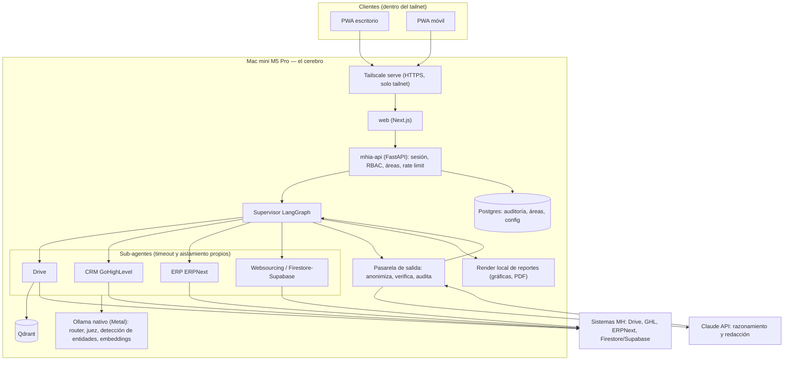
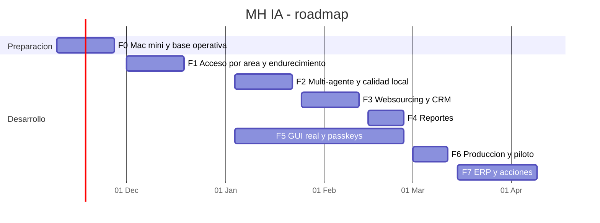

# Plan maestro — MH IA, el cerebro de Machinery Hunters

**Fecha:** 6 de noviembre de 2026 (rev. 2, con respuestas de Fernando) · **Base revisada:** `develop` en `4e1f9f4` (PR #13)
**Alcance:** revisión del estado actual, arquitectura objetivo, hardware, acceso
remoto, clientes de escritorio y móvil, seguridad y roadmap por fases.

Este documento manda sobre el orden de trabajo. Las decisiones puntuales siguen
viviendo en `docs/ARCHITECTURE.md` (ADR), los riesgos en `SECURITY.md` y los
pasos operativos en `DEPLOYMENT.md`. Cuando una fase cierre, se actualiza aquí
su estado y se mueven sus decisiones a esos documentos.

---

## 0. Resumen ejecutivo

1. **La base es sólida y está por encima de lo habitual para un proyecto de una
   sola persona.** La frontera de privacidad (anonimizador determinista, pasarela
   de salida única, fallo cerrado), la autenticación (argon2id, sesiones en
   servidor, TOTP) y la recuperación híbrida medida están hechas y probadas.
   Validado hoy: ruff y black limpios, **588 pruebas en verde**, GUI con lint,
   typecheck, pruebas y build en verde, `pip-audit` y `npm audit` sin
   vulnerabilidades conocidas.
2. **El hueco más importante no es técnico, es de modelo de acceso.** Hoy se
   filtra por nivel de sensibilidad, no por área. Un líder de Ventas ve
   Administración. Eso se arregla **antes** de conectar más sistemas, porque cada
   conector nuevo multiplica el problema.
3. **"Orquestador" sí, pero con una regla dura:** Claude nunca se conecta
   directamente a CRM, ERP ni Drive (ni por MCP). Los conectores corren en la
   Mac mini, bajo el control del supervisor local, y a Claude solo llega
   contexto anonimizado por la pasarela de salida.
4. **Claude no genera imágenes.** Los reportes con gráficas se resuelven
   localmente (Claude escribe la especificación, la Mac la dibuja con los datos
   reales). Las imágenes "creativas" requieren otro proveedor y solo con
   contenido público. Ver sección 2.6.
5. **Acceso remoto: Tailscale** (ya elegido) es la mejor opción para su caso,
   con SSO de Google Workspace, MFA, aprobación de dispositivos y reglas de
   acceso por etiqueta. Cloudflare Tunnel queda descartado por privacidad: el
   tráfico se descifra en Cloudflare.
6. **Clientes: PWA** sobre el Next.js actual para escritorio y móvil. Sin apps
   nativas mientras no exista una necesidad que la PWA no cubra.
7. **Mac mini M5 Pro de 48 GB:** Ollama nativo (Metal), todo lo demás en
   contenedores ARM64 con Colima, arranque automático con `launchd`, FileVault,
   UPS y backups cifrados con restauración probada.
8. **Orden:** hasta el 27 de noviembre solo se prepara la Mac mini y se cierra lo
   que no compite con Minutas IA. El desarrollo pesado arranca el 1 de
   diciembre y llega a piloto con usuarios reales en unas 10–12 semanas.
9. **Accesos por área desde el Excel:** 11 áreas y 5 roles, con nivel de
   sensibilidad por área. Cada jefe ve su área (e inventario si lo usa), Dirección
   ve todo a nivel confidencial, y Sistemas administra sin leer datos. Ver 2.5.1.
10. **Desarrollo sin costo recurrente hasta aprobar presupuesto:** modelo local por
    defecto y un crédito de Claude de US$5–10 solo para validar (sección 8.1).
11. **Presupuesto estimado:** US$310–515 de pago único y US$153–380 al mes en
    operación con 12 personas; en desarrollo, US$21–64 al mes. Ver sección 8.

---

## 1. Revisión del estado actual (opinión franca)

### 1.1 Qué hay hoy

| Área | Estado | Evidencia |
|---|---|---|
| Pipeline LangGraph | Router → retriever híbrido → juez local → anonimizador → pasarela de salida → Claude, con aborto sin evidencia | `pipeline_ai/graph.py`, `nodes/` |
| Privacidad | Redactor determinista (el código reemplaza, el modelo solo detecta nombres), scrubber que bloquea si quedan hallazgos, restauración local | `privacy/`, `tests/test_graph_privacy_e2e.py` |
| Recuperación | Densa + BM25 en Qdrant con fusión RRF, juez en Ollama, umbral de respaldo. Laboratorio: recall 0.81 → 1.00, precisión 0.16 → 0.68 | `retrieval/`, `lab/evaluar_recuperacion.py` |
| Autenticación | argon2id, sesiones en servidor (SQLite), freno de fuerza bruta, TOTP obligatorio para `control_total`, CSRF por `SameSite=Strict` + `Origin` | `security/`, `api/auth_routes.py` |
| Autorización | 4 roles con permisos por endpoint y filtro por dominio en Qdrant con segunda capa | `security/roles.py`, `security/access.py` |
| Multi-agente | Sub-agente con timeout y aislamiento, y supervisor de consolidación: **escritos y probados, todavía no cableados** al grafo | `agents/` |
| Conectores | Drive funciona (ingesta incremental). ERP, CRM y Firestore son stubs con `ConnectorSpec` | `connectors/` |
| GUI | Next.js 16 + React 19 + Tailwind 4, PWA, login con TOTP, `/consultar` con fuentes | `web/` |
| Infraestructura | Compose endurecido (`cap_drop: ALL`, `read_only`, `no-new-privileges`, puertos solo en `127.0.0.1`, red `backend` separada de `edge`), overrides GPU/Mac/dev | `docker-compose*.yml` |
| CI | ruff, black, pytest, GUI (lint, typecheck, test, build), gitleaks, compose válido, build amd64 + arm64 | `.github/workflows/ci.yml` |
| Proceso | Ramas cortas → PR a `develop`, `main` estable, hook pre-push, `SECURITY.md` vivo | `CONTRIBUTING.md`, `.githooks/` |

### 1.2 Fortalezas

- **La privacidad es estructural, no un prompt.** El reemplazo de datos lo hace
  código determinista y hay una sola salida hacia Claude. Esa es la decisión que
  hace viable todo lo demás.
- **Fallo cerrado en todos lados:** carpeta desconocida = invisible, rol
  desconocido = sin permisos, sin evidencia = no se llama a Claude, juez caído =
  umbral (más ruido, nunca más acceso).
- **Se mide antes de afirmar.** Laboratorio con canarios, golden set de 31
  preguntas, pruebas de mutación (17/17 detectadas en el PR de RBAC).
- **Testeable sin servicios reales** gracias a la carga perezosa de clientes.
- **Portabilidad pensada desde el inicio:** nada en el código depende de CUDA y
  la imagen de la API ya compila para ARM64 en CI.

### 1.3 Riesgos y deuda (ordenados por impacto)

1. **Acceso por sensibilidad, no por área.** Es el riesgo número uno para un
   "cerebro" de toda la empresa. Además falta `allowed_roles` por documento.
2. **Las métricas salen de datos sintéticos.** 8 documentos de laboratorio y 2
   hojas reales. Las cifras del juez y del anonimizador no son todavía evidencia
   de producción.
3. **El modelo local es el eslabón débil de la anonimización.** `llama3.1:8b`
   detecta nombres en español con limitaciones; un nombre no detectado viaja a
   Claude (SECURITY.md §3.3). Con 48 GB en la Mac hay margen para modelos
   mejores, pero hay que medirlos.
4. **Dependencias sin fijar.** `requirements.txt` usa `>=` sin lockfile, la
   imagen base es `python:3.12-slim` sin digest y el CI usa `gitleaks:latest`.
   La laptop y la Mac pueden terminar con versiones distintas, y un paquete
   comprometido entra sin aviso.
5. **Divergencia dev/prod en Ollama.** En la laptop corre en Docker con GPU; en
   la Mac, nativo. Son dos formas distintas de fallar.
6. **El multi-agente no está cableado.** `graph.py` sigue lineal sobre Drive.
   Hasta cablearlo, el sistema todavía no es un orquestador.
7. **Auditoría solo en logs.** No hay almacén propio ni protección contra
   alteración, ni registro de qué fuente concreta vio cada usuario.
8. **Sin backups automatizados ni rotación de secretos.** Están mencionados en
   SECURITY.md, pero mezclados dentro del punto 10 (relevancia). Deben ser
   puntos propios para que no se pierdan.
9. **Documentación con deriva.** `ARCHITECTURE.md` dice que `/query` responde
   501 (ya no), el README remite al SRS para el estado, y la memoria del
   proyecto decía 32 GB para la Mac (son 48 GB). Se corrige al cerrar cada fase.
10. **Factor bus de una persona.** Todo el conocimiento operativo vive en
    Fernando. Los runbooks de la sección 3.6 y este plan son parte de la
    mitigación.

### 1.4 Huecos de seguridad abiertos (resumen de SECURITY.md §3)

| # | Hueco | Fase que lo cierra |
|---|---|---|
| 1 | Cambio de contraseña, passkeys, auditoría de autenticación | F1 (contraseña y auditoría: **hechos**, bloque 4) y F5 (passkeys) |
| 2 | Nombres de documentos en logs INFO | F1 (**hecho**, bloque 4) |
| 3 | Nombres no detectados por el modelo local | F2 (entidades en ingesta + mejor modelo) |
| 4 | Filtro solo por dominio, sin áreas ni `allowed_roles` | **F1** |
| 5 | Auditoría sin almacén ni integridad | F1 (**hecho**, bloque 4; falta anclar la cabeza fuera del equipo) |
| 6 | Sin rate limiting general | F1 (consulta por persona: **hecho**, bloque 4) |
| 7 | Inyección de instrucciones vía documentos | F2 (prueba adversarial) |
| 8 | Eval del router al 89 % | F2 |
| 9 | Listas blancas de campos de ERP/CRM/Firestore | F3 / F7 |
| 10 | Juez tolerante; backups, rotación y escaneo sin implementar | F0 (backups), F1 (escaneo, rotación) |
| 11 | Sin CSP con nonce | F5 |

---

## 2. Arquitectura objetivo

### 2.1 Principios (no negociables)

1. **Los datos crudos no salen de la Mac mini.** Solo sale contexto anonimizado,
   por una sola puerta (la pasarela de salida), con auditoría.
2. **Cero alucinaciones:** sin evidencia suficiente, el sistema lo dice.
3. **Permisos por usuario reales:** cada consulta se ejecuta con la identidad,
   el rol y las áreas de quien pregunta, aplicados en el servidor, en cada
   fuente.
4. **Solo lectura por defecto.** Cualquier escritura en un sistema (crear un
   lead, mover una etapa) es una acción explícita, con confirmación humana y
   auditoría. No llega antes de la fase 7.
5. **Claude no tiene herramientas ni conectores.** Razona y redacta sobre lo que
   se le entrega; no puede pedir más datos por su cuenta.

### 2.2 Vista general



### 2.3 Flujo de una consulta

1. La PWA envía la pregunta a la API con la cookie de sesión.
2. La API resuelve el **principal**: usuario, rol, áreas y permisos. Aplica rate
   limit y registra el inicio en auditoría.
3. El **router local** clasifica intención y dominios probables, y decide qué
   sub-agentes invocar (solo los que el principal tiene permitido).
4. El **supervisor** lanza los sub-agentes en paralelo (`Send` de LangGraph).
   Cada sub-agente:
   - consulta su sistema con la credencial de servicio de solo lectura,
   - **filtra por el principal** (áreas, rol, lista blanca de campos),
   - extrae y anonimiza lo suyo,
   - devuelve un `SourceResult` con estado (`ok`, `timeout`, `unavailable`,
     `not_configured`, `forbidden`).
5. Si ninguna fuente aportó evidencia: respuesta "sin evidencia", sin llamar a
   Claude.
6. La **pasarela de salida** une la pregunta y el contexto, vuelve a
   anonimizar, bloquea si quedan hallazgos, registra el hash y llama a Claude
   con la lista de fuentes caídas.
7. La respuesta se **restaura localmente** (marcadores → valores reales) solo
   para lo que el usuario puede ver, y se entrega con citas.

### 2.4 Conectores y MCP: cómo encaja el "orquestador"

**Decisión por defecto:** los conectores siguen siendo **módulos Python dentro
de `pipeline_ai`** con el contrato actual (`ConnectorSpec` + `extract`),
envueltos por el sub-agente. No se agrega un bus de mensajes ni microservicios.

**MCP, sí, pero solo de un lado.** MCP es útil como forma estándar de exponer
herramientas, y hay servidores MCP para Drive y otros sistemas. El riesgo es
que la API de Anthropic ofrece un "conector MCP" que llama a los servidores
**desde la infraestructura de Anthropic**: eso mandaría datos crudos fuera de
casa y rompe el principio 1. Por eso:

| Uso de MCP | Veredicto |
|---|---|
| Claude (API) llamando directamente a MCP de CRM/ERP/Drive | **Prohibido** |
| Sub-agente local usando un cliente MCP contra un servidor MCP local (en la Mac) | Permitido, si el servidor es de confianza, está fijado por versión y corre con credencial de solo lectura |
| Exponer los conectores de MH IA como servidor MCP local para Claude Code de Fernando (desarrollo) | Opcional, útil para depurar, nunca con datos de producción |

**Plantilla de un conector nuevo (checklist):**

- `ConnectorSpec` con `default_sensitivity` (piso), `required_settings` y
  timeout propio.
- Credencial de servicio **de solo lectura** y con el alcance mínimo, cargada
  con `settings.require()` en el punto de uso.
- **Lista blanca de campos**: lo que no está en la lista no se lee.
- Mapeo de cada registro a **área(s) propietaria(s)** para el filtro por
  usuario.
- Pruebas de contrato con respuestas grabadas y anonimizadas; ninguna
  credencial real en CI.
- Entrada en `SECURITY.md` con lo que el conector puede leer y por qué.

**Sistemas y modo de acceso:**

| Sistema | Modo | Sensibilidad por defecto | Notas |
|---|---|---|---|
| Google Drive | Indexado en Qdrant (documentos) | INTERNAL, sube por dominio/área | Ya funciona. Área por correo del dueño (ver 2.5) |
| Websourcing / SourcingBot (Firestore/Supabase) | En vivo, consultas parametrizadas | CONFIDENTIAL | Primero de los nuevos: los datos ya existen y el repo `websourcing-app` es propio |
| CRM GoHighLevel | En vivo, token de integración privada con scopes de solo lectura | CONFIDENTIAL | Lista blanca estricta: sin teléfonos ni correos de contactos hacia Claude |
| ERP ERPNext | En vivo, usuario API con rol de solo lectura y DocTypes en lista blanca | CONFIDENTIAL / RESTRICTED (finanzas) | No bloquea nada; llega cuando el proveedor entregue |
| Minutas IA | Fuera de alcance hasta después del 27 de noviembre | — | Proyecto separado; integración solo por decisión explícita |

**Por qué en vivo y no indexar registros:** se mantiene ADR-002. Los registros
cambian, son más sensibles y una copia en Qdrant sería otra base que proteger y
sincronizar. Si se necesita búsqueda semántica sobre registros, se evalúa una
colección `mhia_records` aparte.

### 2.5 Permisos por usuario: rol × área × documento

Es el cambio de modelo más importante del plan y la condición para conectar
cualquier sistema nuevo.

- **Usuario:** `rol` (qué puede hacer) + membresías `{área: nivel máximo}`
  (por ejemplo `{comercial: CONFIDENTIAL, inventario: CONFIDENTIAL}`).
- **Recurso** (fragmento de Drive o registro de un sistema): `sensitivity` +
  `allowed_areas[]` + `allowed_roles[]` opcional + `owner_email` (procedencia).
- **Regla:** un usuario ve un recurso si tiene membresía en al menos una de sus
  áreas con un nivel que cubre la sensibilidad del recurso (o el recurso es
  `general` e INTERNAL o menor), salvo excepción explícita en `allowed_roles`.
  `control_total` y `configuracion` no ven datos por su rol; ven lo que sus
  membresías permitan.
- **Origen del área en Drive:** el correo del dueño del archivo se traduce a
  área con la tabla `correo → áreas` (sección 2.5.1). Un archivo de un
  dueño sin área asignada **no se indexa** (mismo criterio de fallo cerrado que
  las carpetas desconocidas).
- **Dónde vive:** la tabla de usuarios y áreas pasa a Postgres, administrable
  desde la GUI por `configuracion`, con auditoría de cada cambio.

#### 2.5.1 Áreas y roles iniciales (a partir del Excel del 6 de noviembre)

El Excel `correos y roles.xlsx` trae 12 personas con correo, nombre y puesto.
**Ese archivo no entra a git** (son datos personales): se importa a Postgres
con la CLI desde una carpeta ignorada (`services/pipeline_ai/data/`, y en la
fase 1 se agregan `**/data/*.csv` y `**/data/*.xlsx` al `.gitignore`). Aquí solo
queda el diseño por puesto.

**Cambio de modelo:** el nivel de sensibilidad deja de ser global por rol y
pasa a ser **por área**. El rol define qué puede *hacer* la persona (consultar,
configurar, administrar); cada membresía de área define hasta qué nivel puede
*ver* en esa área. Así RH y Finanzas pueden ver lo RESTRICTED de su área sin
ver lo de las demás.

**Áreas** (identificador estable → dominio actual de Drive):

| Área | Dominio de Drive hoy | Nota |
|---|---|---|
| `direccion` | — (nuevo) | Documentos de Dirección |
| `comercial` | `ventas` | |
| `sourcing` | `proveedores` | Incluye Websourcing/SourcingBot |
| `logistica` | — (nuevo) | Hoy cae en carpeta sin dominio y no se indexa |
| `marketing` | — (nuevo) | |
| `proyectos` | `proyectos` | |
| `finanzas` | `administracion` | Puede contener RESTRICTED |
| `rh` | — (nuevo) | Nómina y expedientes: RESTRICTED |
| `taller` | — (nuevo) | |
| `inventario` | `inventario` | Área transversal: varias áreas la consultan |
| `general` | `general` | Visible para todo usuario autenticado |

**Roles** (alineados con los de Minutas IA para no tener dos vocabularios):

| Rol | Puede |
|---|---|
| `consulta` | Consultar en sus áreas |
| `lider` | Consultar en sus áreas, ver el estado de sus fuentes |
| `direccion` (nuevo) | Consultar en todas las áreas a nivel CONFIDENTIAL; RESTRICTED solo donde se le asigne |
| `configuracion` | Administrar usuarios, áreas y conectores (sin ver valores de secretos); no da acceso a datos por sí mismo |
| `control_total` | Infraestructura y secretos; **no da acceso a datos por sí mismo** |

**Asignación propuesta por puesto** (nivel máximo por área; `general` en todos):

| Puesto | Rol | Áreas y nivel |
|---|---|---|
| CEO | `direccion` | Todas CONFIDENTIAL; `finanzas` y `rh` RESTRICTED |
| Director General | `direccion` | Todas CONFIDENTIAL; `finanzas` y `rh` RESTRICTED |
| Asistente del CEO | `consulta` | `direccion` INTERNAL |
| Jefe comercial | `lider` | `comercial` CONFIDENTIAL, `inventario` CONFIDENTIAL |
| Jefe de logística | `lider` | `logistica` CONFIDENTIAL, `inventario` CONFIDENTIAL |
| Jefe de sourcing | `lider` | `sourcing` CONFIDENTIAL, `inventario` CONFIDENTIAL |
| Jefa de marketing | `lider` | `marketing` CONFIDENTIAL, `inventario` INTERNAL |
| Jefa de proyectos | `lider` | `proyectos` CONFIDENTIAL |
| RH | `lider` | `rh` RESTRICTED |
| Jefa de finanzas | `lider` | `finanzas` RESTRICTED |
| Gerente de taller | `lider` | `taller` CONFIDENTIAL, `inventario` CONFIDENTIAL |
| Sistemas (Fernando) | Dos cuentas: `control_total` sin áreas de datos (administración) y `lider` con `general` (uso diario) | Acceso a datos de otra área solo por permiso temporal, con caducidad y auditado |

Criterios detrás de esta propuesta:

- **Menor privilegio:** cada jefe ve su área e inventario cuando lo usa para
  trabajar, no las demás áreas.
- **Sistemas no es un súper lector.** Administrar el sistema no debe implicar
  leer nómina o finanzas; si hace falta depurar con datos reales, se pide un
  permiso temporal que queda registrado.
- **Dirección ve todo a nivel confidencial**, y lo restringido (finanzas, RH)
  porque así lo espera el negocio. Si Dirección prefiere que RH sea solo de RH,
  basta con quitar esa membresía.

Esta tabla es el valor por defecto de la fase 1; **conviene que Dirección la
revise** antes de importar el Excel (sección 9.2).

> **Estado (9 nov 2026):** implementado en el bloque 2 con la base de usuarios
> actual (SQLite, `auth.db`): áreas y niveles, filtro en Qdrant y en Python,
> RESTRICTED sin salida a Claude, rol `direccion`, presets por puesto
> (`security/presets.py`) e importación con `manage import-users`. Pendientes:
> área por correo del dueño, permiso temporal auditado y la validación de esta
> tabla por Dirección. Postgres llegó en el bloque 2b (ver sección 2.7).
- **Por qué no OAuth por usuario como base:** se discutió el 20 de octubre. Da a
  MH IA acceso a archivos personales, complica la búsqueda semántica y no
  resuelve el permiso por área. Se reserva para el futuro, solo en sistemas
  donde el permiso nativo por usuario sea la única fuente de verdad.

### 2.6 Qué hace la IA local y qué hace Claude

| Tarea | Dónde | Por qué |
|---|---|---|
| Clasificar intención y dominio | Ollama | Toca la pregunta cruda |
| Juez de relevancia | Ollama | Toca fragmentos crudos |
| Detectar entidades (nombres, empresas) | Ollama + listas conocidas de la ingesta | Toca datos crudos |
| Reemplazar datos (RFC, CURP, montos, correos, nombres) | Código determinista | Garantía, no probabilidad |
| Embeddings | Ollama | Indexa contenido crudo |
| Razonar, sintetizar, redactar reportes | Claude | Calidad; solo ve contexto anonimizado |
| Gráficas de reportes | **Local**: Claude devuelve una especificación (tipo de gráfica, series con marcadores), la Mac la dibuja con los datos reales | Los números reales nunca salen |
| PDF o DOCX de reportes | Local (plantilla + render) | Igual |
| Respuesta cuando Claude no está disponible o el contenido es RESTRICTED | Modelo local grande (respaldo) | Continuidad y datos que nunca deben salir |
| Imágenes creativas (marketing, fichas de maquinaria) | **Por defecto, local en la Mac** (modelo de difusión en lotes; lento pero sin salida de datos). Proveedor externo: decisión abierta, en gestión (sección 9.2); si se aprueba, solo con contenido PUBLIC y por la pasarela de salida | Claude no genera imágenes |

Modelo de Claude por defecto: el modelo Sonnet vigente para consultas, y Opus
solo para reportes largos o análisis complejos. Va en configuración
(`CLAUDE_MODEL_DEFAULT`, `CLAUDE_MODEL_REPORTS`), con un tope de gasto mensual en
la consola de Anthropic.

### 2.7 Datos y almacenamiento

| Almacén | Contenido | Decisión |
|---|---|---|
| Qdrant | Fragmentos de Drive (vector denso + BM25) con payload `domain`, `sensitivity`, `allowed_areas`, `allowed_roles`, `owner_email` | Una colección por tipo de contenido; índices de payload en los campos de filtro |
| Postgres (nuevo) | Usuarios, áreas, mapeo correo → área, configuración de conectores (sin secretos), auditoría | Entra en la fase 1. Auditoría en tabla solo de inserción, con un hash encadenado por fila para detectar alteraciones |
| SQLite (`auth.db`) | Usuarios y sesiones | **Hecho (9 nov 2026, bloque 2b):** usuarios, áreas, sesiones y registro de cambios de permisos en Postgres; el `auth.db` se migra solo al primer arranque. SQLite queda solo para pruebas y desarrollo sin Docker. Hash encadenado del registro y eventos de login y de consulta: **hechos** (12 nov 2026, bloque 4). Pendiente: configuración de conectores |
| Secretos | `.env` del host + `credentials/` | Fuera de git, fuera del backup común; respaldo en gestor de contraseñas |

---

## 3. Hardware y despliegue

### 3.1 Roles de cada equipo

| | Laptop Predator Helios Neo 16S | Mac mini M5 Pro |
|---|---|---|
| Uso | Desarrollo, laboratorio, CI local | Producción ("el cerebro") |
| SO | Windows + PowerShell | macOS (servidor sin pantalla) |
| Cómputo IA | RTX 5070 Ti, 12 GB VRAM, 32 GB RAM | 48 GB de memoria unificada, GPU Metal |
| Datos reales | **No**, salvo pruebas puntuales y borrado al terminar | Sí |
| Acceso | Local | Solo por tailnet |

### 3.2 Paridad dev/prod

- **Ollama nativo en ambos equipos.** En Windows, Ollama nativo usa CUDA
  directamente y la app lo alcanza igual que en la Mac
  (`OLLAMA_BASE_URL=http://host.docker.internal:11434`). Así el override GPU de
  Docker deja de ser el camino principal (se conserva como opción) y las dos
  máquinas fallan de la misma forma.
- **Mismas versiones fijadas:** lockfile de Python (`uv pip compile` →
  `requirements.lock`), `package-lock.json` (ya existe), imágenes por digest, y
  modelos de Ollama por etiqueta exacta (por ejemplo `qwen3:14b`, no `latest`).
- **Mismo modelo de embeddings en ambos lados.** Cambiarlo obliga a reindexar.
- **Evaluaciones de modelos en la Mac.** La laptop no carga los modelos grandes
  completos en VRAM, así que las cifras de calidad y latencia que cuentan son
  las de la Mac.

### 3.3 Modelos locales recomendados (candidatos a medir, no decisiones)

Presupuesto de memoria de la Mac (48 GB unificados):

| Consumidor | Reserva |
|---|---|
| macOS y servicios | ~6 GB |
| VM de Colima (API, web, Qdrant, Postgres) | 8 GB fijos |
| Modelo de trabajo (router, juez, entidades) | ~10 GB |
| Embeddings | ~1 GB |
| Modelo de respaldo grande (bajo demanda) | ~18–20 GB |
| Margen | el resto |

| Función | Hoy | Candidatos a medir en la Mac | Criterio de elección |
|---|---|---|---|
| Router, juez, detección de entidades | `llama3.1:8b` | Qwen3 14B, Gemma 3 12B (cuantización Q4/Q5) | Recall de entidades en español con canarios, precisión del juez en el golden set real, latencia p95 |
| Embeddings | `nomic-embed-text` | Mantener; evaluar `bge-m3` o Qwen3-Embedding solo si el recall real cae | Recall@k en el golden set real. Cambiarlo obliga a reindexar |
| Respaldo local (sin Claude, o RESTRICTED) | — | Qwen3 30B-A3B (MoE, rápido en Apple Silicon), gpt-oss 20B | Calidad de síntesis con citas; que no dispare la memoria |

En la laptop, el modelo de trabajo de 12–14B en Q4 cabe en los 12 GB de VRAM.
El de respaldo no cabe completo; se prueba solo en la Mac.

Variables de Ollama en la Mac: `OLLAMA_HOST=127.0.0.1:11434`,
`OLLAMA_MAX_LOADED_MODELS=2`, `OLLAMA_NUM_PARALLEL=2`, `OLLAMA_KEEP_ALIVE=30m`
para el modelo de trabajo, y el de respaldo con `keep_alive` corto. macOS limita
por defecto la memoria que la GPU puede fijar; si un modelo no carga, se revisa
ese límite (`iogpu.wired_limit_mb`) con cuidado de dejar memoria al sistema.

### 3.4 Pila en la Mac mini

| Pieza | Decisión | Por qué |
|---|---|---|
| Ollama | Nativo con `brew`, servicio `launchd`, solo en `127.0.0.1` | Docker en macOS no pasa la GPU Metal a contenedores |
| Contenedores | **Colima** (sin interfaz, CLI, gratuito) | Docker Desktop es cómodo, pero su licencia depende del tamaño de la empresa; Colima arranca bien sin sesión gráfica. La herramienta `container` de Apple se revisa más adelante |
| API, web, Qdrant, Postgres | Compose actual + `docker-compose.host-ollama.yml` + servicio Postgres | Todas las imágenes son ARM64 |
| Arranque automático | `launchd` para Ollama y Colima; `restart: unless-stopped` + healthchecks en compose | Validado con un reinicio real, no supuesto |
| Red remota | Tailscale como servicio del sistema (arranca antes del login) | Ver sección 4 |
| Disco | FileVault activo | Protege ante robo del equipo |
| Energía | UPS + `pmset autorestart 1`, sin suspensión | Ver trade-off de FileVault |
| Cuentas | Una administradora (mantenimiento) y una estándar `mhia` que corre los servicios | Mínimo privilegio |
| Acceso al host | SSH solo con llave y solo por tailnet; compartir pantalla apagado salvo necesidad, y solo por túnel SSH | Superficie mínima |

**Ubicación (decidido el 6 de noviembre):** la Mac queda físicamente en poder
de Fernando, conectada por Ethernet. Consecuencias:

- Fernando es el custodio físico: él desbloquea FileVault tras un corte y es
  el único con acceso al equipo. Bien para la confidencialidad, pero concentra
  el riesgo en una persona.
- **Llave de recuperación de FileVault** guardada en el gestor de contraseñas
  de la empresa, con acceso de Dirección, por si Fernando no está disponible.
- Si la Mac cambia de red (por ejemplo, oficina y otro sitio), Tailscale sigue
  funcionando sin tocar nada: no depende de IP fija ni de puertos en el router.
  Basta con reservar IP por DHCP en la red donde esté, para el SSH local.
- UPS sigue siendo necesario donde esté conectada.

**Trade-off FileVault:** tras un corte de luz que agote el UPS, la Mac espera la
contraseña del disco y nada arranca hasta que Fernando la teclee en persona. Se
acepta (va en SECURITY.md §2): el UPS cubre cortes cortos y los reinicios
planeados usan `sudo fdesetup authrestart`.

### 3.5 Backups y restauración

| Qué | Cómo | Frecuencia | Retención |
|---|---|---|---|
| Qdrant | Snapshot por API (`POST /collections/{c}/snapshots`) | Diario | 14 días |
| Postgres | `pg_dump` en formato custom | Diario | 30 días |
| Manifest de sync y configuración | Copia de `data/` (sin secretos) | Diario | 30 días |
| Destino 1 | Disco externo cifrado (APFS cifrado) conectado a la Mac | — | — |
| Destino 2 | Copia cifrada fuera de la oficina (por ejemplo `restic` hacia un almacenamiento de objetos, con llave que solo tiene Fernando) | Semanal | 8 semanas |
| Secretos | Gestor de contraseñas, nunca en el backup común | Al cambiar | — |

Un backup no existe hasta que se restaura. **Simulacro de restauración
mensual** en la laptop: levantar Qdrant y Postgres desde el último backup y
correr la prueba de humo.

### 3.6 Monitoreo y operación

- **Salud:** script de `launchd` cada 5 minutos que revisa `/health` de la API,
  Ollama, Qdrant, Postgres, espacio en disco y la edad del último backup.
  Alerta por correo o al celular de Fernando (por ejemplo con ntfy alojado en
  la propia Mac, accesible solo por el tailnet).
- **Métricas:** Qdrant ya expone `/metrics`. Prometheus y Grafana quedan para
  cuando haya más de 10 usuarios activos; antes, el script y los logs bastan.
- **Logs:** JSON estructurado, rotación diaria, 30 días, sin contenido de
  consultas (ya es así) y sin nombres de documentos (fase 1).
- **Runbooks** en `docs/runbooks/`: reinicio tras corte de luz, restauración,
  rotación de secretos, alta y baja de usuario, revocación de un dispositivo
  perdido.
- **Actualizaciones:** parches de seguridad de macOS automáticos; versiones
  mayores de macOS, Ollama, Qdrant y modelos solo tras probarlos en la laptop.

---

## 4. Acceso remoto para usuarios fuera de la oficina

### 4.1 Requisitos

Nada expuesto a internet, autenticación con SSO y MFA, control por dispositivo,
revocación inmediata, uso sencillo desde celular, y que el proveedor no vea el
contenido.

### 4.2 Comparación

| Opción | Puertos abiertos | SSO y MFA | Control por dispositivo | ¿El proveedor ve el tráfico? | Operación | Veredicto |
|---|---|---|---|---|---|---|
| **Tailscale** | Ninguno | Sí (Google Workspace, Microsoft, etc.) | Aprobación de dispositivos, expiración de llaves, reglas por etiqueta, Tailnet Lock opcional | **No**: WireGuard de punta a punta; el plano de control solo coordina llaves | Muy baja | **Recomendado** |
| Cloudflare Tunnel + Access | Ninguno | Sí | Postura de dispositivo con WARP | **Sí**: TLS termina en Cloudflare | Baja | Descartado para datos internos; útil solo para algo público |
| WireGuard propio | Uno (UDP) en el router | No nativo | Manual, por llave | No | Alta: llaves, IP, revocación a mano | Descartado: abre un puerto y no tiene SSO |
| Headscale (Tailscale autoalojado) | Uno (HTTPS) para el plano de control | Vía OIDC | Sí | No | Media: otro servicio que mantener y exponer | Plan B si Dirección exige infraestructura 100 % propia |
| NetBird / ZeroTier / Twingate | Ninguno | Sí | Sí | No (NetBird, ZeroTier) / depende (Twingate) | Baja | Alternativas válidas; no superan a Tailscale aquí |

### 4.3 Recomendación: Tailscale, configurado así

1. **Identidad:** iniciar sesión en Tailscale con Google Workspace
   (`machineryhunters.com`), con MFA obligatorio en Google. **Workspace lo
   administra Marketing**, así que esto se coordina con ellos. Lo que hay que
   pedirles, en una sola solicitud:
   - Permitir la app de Tailscale en Workspace (acceso de terceros por OAuth),
     si está restringido.
   - Exigir verificación en dos pasos a las 12 cuentas que usarán MH IA.
   - Crear el grupo `mhia-usuarios@machineryhunters.com` (opcional, facilita
     altas y bajas).
   - Avisar a Fernando cuando alguien salga de la empresa, porque desactivar
     su cuenta de Google corta su acceso al tailnet.
   El tailnet lo crea Fernando con su cuenta corporativa y queda como dueño;
   Marketing no necesita acceso a la consola de Tailscale. Mientras Marketing
   responde, Fernando puede usar el tailnet solo con sus dispositivos.
2. **Dispositivos:** aprobación manual de cada dispositivo nuevo y expiración
   de llaves activa (90 días). Activar Tailnet Lock cuando el número de
   dispositivos se estabilice.
3. **Reglas de acceso (grants/ACL) por etiqueta:**
   - `tag:mhia-brain` es la Mac mini.
   - `group:mhia-usuarios` → `tag:mhia-brain:443` (solo la GUI).
   - `group:mhia-admin` (Fernando) → `tag:mhia-brain:22,443`.
   - Nadie más llega a nada.
4. **Publicación:** `tailscale serve` en HTTPS con el certificado del tailnet
   (`https://mhia-brain.<tailnet>.ts.net`). **Nunca `tailscale funnel`**.
5. **Celulares:** app de Tailscale en iOS y Android con la misma cuenta; la PWA
   se instala desde esa URL HTTPS.
6. **Baja de un usuario:** se desactiva en Google Workspace (corta el tailnet) y
   en MH IA (corta la sesión). Un dispositivo perdido se elimina de la consola
   de Tailscale y se revocan sus sesiones en la API.
7. **Plan:** el plan gratuito alcanza para Fernando y pocas personas; al sumar a
   Dirección y líderes se pasa al plan de pago por usuario. Revisar el precio
   vigente antes de la fase 6.

La capa de aplicación (login, TOTP o passkey, rol y área) sigue siendo
obligatoria encima de la red. Estar en el tailnet no da acceso a datos.

---

## 5. Clientes de escritorio y móvil

### 5.1 Comparación

| Opción | Escritorio | Móvil | Código | Distribución | Seguridad | Costo para una persona |
|---|---|---|---|---|---|---|
| **PWA (Next.js actual)** | Instalable en Chrome/Edge | Instalable en Android e iOS (Web Push en iOS desde 16.4 si está instalada) | Uno | URL del tailnet, sin tiendas | Toda la lógica en el servidor; passkeys dan biometría | Mínimo: ya existe |
| Tauri | Nativa ligera | Móvil todavía joven | Web + Rust | Instaladores firmados | Buena, pero más superficie que mantener | Medio |
| Electron | Nativa pesada | No | Web + Node | Instaladores firmados | Más superficie (Node en el cliente) | Medio |
| React Native / Expo | No (o con otra capa) | Nativa | Segundo código de UI | Tiendas o MDM | Buena | Alto |
| Flutter | Sí | Sí | Otro lenguaje (Dart) | Tiendas | Buena | Alto |

### 5.2 Recomendación

**PWA** como único cliente, por estas razones:

- Ya está construida, con login, TOTP y consulta.
- Un solo código para escritorio y móvil, mantenido por una sola persona.
- No guarda datos en el dispositivo (el service worker no cachea respuestas):
  un celular perdido no se lleva información.
- Passkeys (WebAuthn) dan biometría del dispositivo sin app nativa.

**Cuándo reconsiderar:** si se necesitan notificaciones push confiables en iOS
para alertas operativas, acceso a archivos locales del escritorio o modo sin
conexión. En ese caso, Tauri para escritorio o un contenedor Capacitor/Expo
para móvil, envolviendo la misma PWA y sin duplicar la lógica.

Pendientes de la PWA: dirección visual propia (`docs/GUI_DIRECCION_VISUAL.md`),
render seguro de Markdown en respuestas, estado por fuente en cada respuesta,
pantallas de administración de usuarios y áreas, y CSP con nonce.

---

## 6. Seguridad

### 6.1 Activos

1. Datos de negocio: clientes, precios, márgenes, finanzas, nómina, proveedores.
2. Credenciales de los sistemas (Drive, GHL, ERPNext, Firestore/Supabase,
   Anthropic).
3. Identidades y sesiones de usuarios.
4. Integridad de las respuestas (decisiones se toman con ellas).
5. La Mac mini misma (disco, backups).

### 6.2 Modelo de amenazas

| Amenaza | Vector | Control actual | Control a agregar | Fase |
|---|---|---|---|---|
| Fuga de datos a Claude | Nombre no detectado, campo no previsto | Redactor determinista, scrubber que bloquea, pasarela única | Entidades conocidas desde la ingesta, mejor modelo de detección, listas blancas por conector | F2, F3 |
| Fuga entre áreas | Usuario ve datos de otra área | Filtro por sensibilidad | Filtro rol × área × documento en cada fuente | **F1** |
| Inyección de instrucciones | Texto malicioso en Drive o CRM | Claude sin herramientas, contexto delimitado, citas | Prueba adversarial en CI, marcar contenido sospechoso en la ingesta | F2 |
| Robo de sesión o credencial | Phishing, equipo comprometido | argon2id, sesiones en servidor, TOTP en `control_total`, cookie `httpOnly` + `SameSite=Strict` | Passkeys, MFA para todos los roles con datos confidenciales, expiración y revocación de sesiones desde la GUI | F1, F5 |
| Abuso por usuario autenticado | Extracción masiva de datos | Concurrencia y timeout por consulta | Rate limit por usuario, alerta por volumen anómalo, auditoría de fuentes vistas | F1 |
| Exposición de red | Puerto abierto, servicio mal publicado | Solo `127.0.0.1`, sin puertos de Qdrant ni Ollama | Tailscale con grants, prueba automática de que nada escucha fuera de `127.0.0.1` | F0, F6 |
| Cadena de suministro | Paquete o imagen comprometidos, modelo alterado | `pip-audit` y `npm audit` limpios hoy | Lockfiles, imágenes por digest, Dependabot, Trivy en CI, modelos por etiqueta exacta | F1 |
| Robo o pérdida de la Mac | Acceso físico | — | FileVault, ubicación con acceso controlado, backups cifrados | F0 |
| Pérdida de datos | Falla de disco, error humano | — | Backups diarios con simulacro mensual | F0 |
| Insider con privilegios | `control_total` abusado | Rol más restringido, TOTP | Auditoría con hash encadenado, alerta en cambios de configuración, revisión mensual | F1 |
| Proveedor de IA | Retención de datos en la API | Solo contexto anonimizado | Revisar términos vigentes de retención de la API de Anthropic y solicitar retención cero si aplica; tope de gasto | F1 |

### 6.3 Autenticación y autorización

- **Autenticación:** usuario + contraseña (argon2id) + segundo factor.
  - TOTP obligatorio hoy para `control_total`; se extiende a todo rol que vea
    CONFIDENTIAL o más (fase 1).
  - Passkeys como factor preferido (fase 5).
  - Sin registro público: altas solo por `configuracion` o `control_total`, con
    auditoría.
- **Autorización (RBAC + áreas):** se mantienen los 4 roles y sus permisos, y se
  agrega la dimensión de área de la sección 2.5. Cada endpoint usa
  `require_permission`; cada fuente aplica el filtro del principal. La GUI solo
  oculta, nunca decide.
- **Sesiones:** expiración por inactividad y absoluta, revocación por usuario y
  por dispositivo, listado de sesiones activas en la GUI.

### 6.4 Auditoría

Tabla de solo inserción en Postgres con: fecha, usuario, rol, áreas, sesión,
acción, huella de la consulta (nunca el texto), fuentes consultadas con su
estado, identificadores de fragmentos entregados, hash de lo enviado a Claude,
resultado y latencia. Cada fila guarda el hash de la anterior para detectar
alteraciones. Exportación mensual al backup. Acceso de lectura solo para
`control_total`.

> **Hecho (12 nov 2026, bloque 4):** tabla `audit_log` (Postgres; SQLite en
> pruebas) con categorías `admin`, `acceso` y `consulta`, hash encadenado por fila
> y disparadores de solo inserción. Cada consulta registra persona, rol, áreas,
> sesión, huella y longitud, resultado, proveedor, identificadores de fragmentos
> (también si la respuesta se bloquea), hash del payload de la pasarela y
> latencia; si no se puede registrar, la respuesta no se entrega. Logins, fallos,
> bloqueos, salidas y cambios de contraseña van al mismo registro. Los respaldos
> llevan la cabeza de la cadena y `manage audit-verify --respaldo` detecta una
> cadena rehecha o recortada. Hoy se consulta solo por CLI (`audit-log`, servidor);
> la pantalla para `control_total`, la retención y anclar la cabeza fuera del
> equipo siguen pendientes (SECURITY.md §3.5).

### 6.5 Gestión de secretos

| Secreto | Dónde vive | Rotación |
|---|---|---|
| `ANTHROPIC_API_KEY` | `.env` del host (permisos `600`, dueño `mhia`) | 90 días o ante sospecha |
| Cuenta de servicio de Google | `credentials/` fuera del árbol del repo en la Mac, montado solo lectura | 180 días |
| Token de GHL, llaves de ERPNext, Firestore/Supabase | `.env` del host | 90 días |
| `API_SESSION_SECRET`, `API_TOTP_KEY` | `.env` del host | `API_SESSION_SECRET` al cambiar de entorno; `API_TOTP_KEY` solo con re-enrolamiento |
| Fuente de verdad de todos | Gestor de contraseñas de la empresa | — |

Reglas que ya se cumplen y se mantienen: nada de secretos en git (gitleaks en
CI), fallo explícito si falta un secreto crítico con `MHIA_ENV=production`,
`DEBUG=False` por defecto, documentación de la API apagada sin `DEBUG`.

### 6.6 Cambios a SECURITY.md

- Separar del punto 10 de la sección 3 los temas de **backups**, **rotación de
  secretos** y **escaneo de dependencias**, cada uno como punto propio.
- Agregar el modelo rol × área (fase 1) y la política de MCP de la sección 2.4.
- Agregar el trade-off de FileVault y UPS en "aceptado como riesgo".
- Agregar la política de imágenes generadas (sección 2.6).

---

## 7. Roadmap por fases

Fechas estimadas para una persona con dedicación principal a MH IA a partir del
1 de diciembre. Cada fase cierra con sus criterios de aceptación; no se empieza
la siguiente sin cumplirlos, salvo las marcadas como paralelas.



### F0 — Mac mini y base operativa (9 al 27 de noviembre, trabajo ligero)

No compite con Minutas IA: es configuración, no lógica de negocio.

- Instalación en persona: cuentas, FileVault, `pmset`, firewall, SSH con llave,
  Tailscale como servicio, UPS.
- Homebrew, Git, Ollama nativo, Colima, modelos actuales.
- Clonar `develop`, levantar con `docker-compose.host-ollama.yml` y correr el
  laboratorio sintético de punta a punta.
- Backups diarios de Qdrant y del manifest, y primer simulacro de restauración.
- Script de salud con alerta.
- Enviar a Marketing la solicitud de la sección 4.3 y pedir a Dirección que valide la tabla de la sección 2.5.1.
- Excel de personas y puestos: **entregado el 6 de noviembre** (fuera de git).

**Aceptación:** tras apagar y encender la Mac (con desbloqueo de FileVault), los
servicios suben solos, la laptop llega por el tailnet a la GUI, el laboratorio
da 14/14 sin fugas y un backup se restaura en la laptop.

### F1 — Acceso por área y endurecimiento (1 al 19 de diciembre)

- Modelo rol × área × documento (sección 2.5) en API, ingesta y retriever.
- Postgres para usuarios, áreas, configuración y auditoría; migración desde
  SQLite.
- Ingesta de Drive con área por correo del dueño; archivos sin área no se
  indexan.
- `allowed_roles` por documento.
- Auditoría con hash encadenado; logs sin nombres de documentos.
- Rate limit por usuario; cambio de contraseña; TOTP para roles con datos
  confidenciales.
- Lockfiles, imágenes por digest, Dependabot y Trivy en CI.
- Ollama nativo también en la laptop (paridad).

**Aceptación:** pruebas automáticas que demuestran que un líder de Ventas no ve
Administración y viceversa (también con servicios reales); mutaciones del
filtro detectadas; auditoría registra fuentes vistas; CI verde con escaneo de
dependencias e imágenes.

### F2 — Multi-agente y calidad local (4 al 22 de enero)

- Cablear el supervisor en `graph.py` con `Send`; Drive como primer sub-agente.
- Claude recibe la lista de fuentes no disponibles.
- Evaluar modelos candidatos (sección 3.3) en la Mac con el golden set real.
- Extraer entidades en la ingesta y usarlas en el scrubber.
- Resolver las 3 fallas del router y agregar casos adversariales, incluida
  inyección de instrucciones.
- `lab/real_golden.json` con al menos 40 preguntas reales.

**Aceptación:** una consulta pasa por supervisor → sub-agente → pasarela →
Claude con citas; con una fuente caída responde con las demás y lo declara;
0 fugas de canarios en el laboratorio y en la prueba adversarial; recall y
precisión medidos con datos reales y registrados en este documento.

### F3 — Websourcing y CRM (25 de enero al 12 de febrero)

- Conector de Websourcing/SourcingBot (Firestore/Supabase), solo lectura, con
  lista blanca de campos y área por registro.
- Conector de GoHighLevel con token de integración privada de solo lectura,
  lista blanca de campos y sin datos de contacto hacia Claude.
- Pruebas de contrato con respuestas grabadas y anonimizadas.

**Aceptación:** una consulta combina Drive + Websourcing + CRM respetando áreas;
si una fuente cae, las demás responden; ningún dato de contacto llega a Claude
(prueba automática).

### F4 — Reportes (15 al 26 de febrero)

- Reportes con plantilla: Claude redacta y entrega la especificación de
  gráficas; la Mac dibuja y arma el PDF con los datos reales.
- Selección de modelo de Claude por tipo de tarea y tope de gasto.

**Aceptación:** un reporte semanal de ventas o sourcing se genera de punta a
punta sin que los números reales salgan de la Mac (verificado en la auditoría).

### F5 — GUI real y passkeys (en paralelo, 4 de enero al 26 de febrero)

- Dirección visual propia, pantallas de consulta con estado por fuente,
  administración de usuarios y áreas, sesiones activas.
- Markdown seguro, CSP con nonce.
- Passkeys para todos los roles, TOTP como respaldo.

**Aceptación:** pruebas de accesibilidad básicas, CSP sin `unsafe-inline`,
passkey funcionando en un iPhone y un Android dentro del tailnet.

### F6 — Producción y piloto (1 al 12 de marzo)

- Reindexar en la Mac, `MHIA_ENV=production`, Tailscale con grants por grupo.
- Runbooks completos y simulacro de restauración.
- Piloto con 3 a 5 personas (Dirección y 2 líderes) durante dos semanas.

**Aceptación:** piloto sin incidentes de acceso indebido, p95 de consulta menor
a 10 s, backups y alertas funcionando, retroalimentación registrada.

### F7 — ERP y acciones (15 de marzo en adelante, según el proveedor)

- Conector ERPNext de solo lectura con DocTypes en lista blanca.
- Primeras acciones de escritura (por ejemplo crear una tarea o nota en el
  CRM) con confirmación humana explícita y auditoría.

**Aceptación:** cada acción queda auditada con quién la pidió y quién la
confirmó; ninguna acción se ejecuta sin confirmación.

### Dependencias

```
F0 ──► F1 ──► F2 ──► F3 ──► F4 ──► F6 ──► F7
              └──── F5 (en paralelo desde enero) ────┘
```

F1 va antes que cualquier conector nuevo porque define cómo se filtra cada
recurso. F7 (ERP) no bloquea nada y puede adelantarse si el proveedor entrega
antes, siempre después de F1.

---

## 8. Presupuesto estimado por fase

Cifras en dólares, de referencia para que Dirección decida. Precios de la API de
Anthropic vigentes a octubre de 2026 por millón de tokens: Sonnet 5.5 US$2 de
entrada y US$10 de salida, Opus 5.5 US$4 y US$20, Haiku 5.5 US$0.10 y US$0.50;
la entrada que se reutiliza con prompt caching cuesta US$0.20 por millón y el
procesamiento por lotes (reportes nocturnos) cuesta la mitad. Los precios de
Tailscale y del hardware deben confirmarse al comprar.

**Supuestos de uso en operación:** 12 personas, unas 15 consultas por persona
por día hábil (≈4,000 al mes), cada consulta con ~6,000 tokens de entrada (2,000
fijos en caché) y ~800 de salida, más el razonamiento del modelo; unos 20
reportes largos al mes con Opus.

| Concepto | Pago único | Mensual en desarrollo (F0–F5) | Mensual en piloto (F6, 5 personas) | Mensual en operación (12 personas) |
|---|---|---|---|---|
| UPS para la Mac | 150–250 | — | — | — |
| 2 discos externos para backup (rotación) | 150–250 | — | — | — |
| Adaptador HDMI "dummy" (si se usa escritorio remoto) | 10–15 | — | — | — |
| API de Claude (Sonnet para consultas, Opus para reportes) | — | 20–50 (pruebas y laboratorio) | 40–70 | 80–150 |
| Tailscale | — | 0 (plan gratuito, pocos usuarios) | 30–90 | 72–216 (6–18 por usuario según plan) |
| Copia de seguridad fuera de la oficina (almacenamiento de objetos) | — | 1–6 | 1–6 | 1–6 |
| Gestor de contraseñas (si la empresa no tiene uno) | — | 0–8 | 0–8 | 0–8 |
| Imágenes externas | — | 0 (local por defecto) | 0 | Por definir si se aprueba |
| **Total** | **310–515** | **21–64** | **71–174** | **153–380** |

Controles para que el gasto no se dispare:

- **Tope de gasto mensual** en la consola de Anthropic: US$100 en desarrollo y
  piloto, US$200 en operación. Si se alcanza, MH IA responde con el modelo local
  de respaldo y lo avisa.
- Caché de las instrucciones fijas en cada consulta, Haiku para tareas simples
  si se necesitan del lado de Claude, y lotes para reportes que no son urgentes.
- Un tablero simple en la GUI (para `control_total`) con gasto por día y por
  tipo de tarea, que sale de la auditoría.
- La cifra real se mide en el piloto y se ajusta este cuadro antes de pasar a
  operación.

El costo de la Mac mini ya está hecho, y no hay licencias de servidor: Colima,
Ollama, Qdrant y Postgres son gratuitos.

### 8.1 Modo sin costo mientras se aprueba el presupuesto (decidido el 6 de noviembre)

**Regla:** durante el desarrollo (F0 a F5) no se paga nada recurrente hasta que
Dirección apruebe el presupuesto. Qué significa en cada pieza:

| Pieza | Cómo se mantiene gratis | Límite a vigilar |
|---|---|---|
| Mac mini, Ollama, Qdrant, Postgres, Colima, Docker | Ya están pagados o son de código abierto | — |
| GitHub y CI | Plan actual de la organización | Los minutos de Actions del plan; el build multiarquitectura es el paso más pesado |
| Tailscale | Plan gratuito (hasta 3 usuarios personales y 100 dispositivos en el plan Personal; confirmar el límite vigente antes de invitar a más gente) | Solo Fernando y 1–2 personas de prueba hasta que haya presupuesto |
| Backups | Disco externo local; la copia fuera de oficina se pospone (o se usa un almacenamiento gratuito pequeño, cifrado con `restic`) | Solo se pierde la copia fuera de oficina, no la local |
| Gestor de contraseñas | El que la empresa ya tenga | — |
| Imágenes | Generación local | Lenta, solo en lotes |
| **Claude (API)** | **La API no tiene plan gratuito: se paga por uso.** Se opera con modo local por defecto y Claude solo en pruebas puntuales | Ver abajo |

**Claude en modo gratuito (`REASONING_MODE=local`):**

- El nodo de razonamiento usa por defecto el **modelo local grande** de la Mac
  (sección 3.3), sin llamar a la API. La calidad de redacción es menor, pero
  basta para desarrollar, probar permisos, ingesta, recuperación y conectores,
  que es el 90 % del trabajo de F1 a F3.
- La pasarela de salida, el anonimizador y las pruebas de fugas **se siguen
  ejecutando igual**, aunque el destino sea el modelo local. Así el
  comportamiento de privacidad se prueba antes de gastar un centavo.
- Para validar la calidad real con Claude se usa un **crédito prepagado
  pequeño** (US$5–10 en la consola de Anthropic, con recarga automática
  apagada y el tope de gasto del espacio de trabajo en ese monto). Alcanza
  para las corridas del laboratorio y del golden set (cientos de consultas con
  Sonnet 5.5 o Haiku 5.5). Si el crédito se acaba, la API deja de responder y
  el sistema cae al modelo local; no hay sorpresas en la factura.
- El laboratorio sintético ya corre con Claude real (14/14, 0 fugas); con este
  modo se corre completo con el modelo local y con Claude solo antes de cada
  entrega de fase.

**Qué se retrasa por no pagar:** el piloto con 5 personas (F6) necesita Claude
real y Tailscale para más de 3 usuarios, así que **F6 depende de que se apruebe
el presupuesto**. F0 a F5 no.

**Cambio de código que implica (entra en F1):** variable `REASONING_MODE`
(`local` | `claude`), con `local` por defecto; el nodo de razonamiento elige el
proveedor sin tocar el resto del grafo, y la prueba de aislamiento (`claude_node`
solo lee el payload de la pasarela) se aplica a ambos.

> **Hecho (12 nov 2026, bloque 3):** `REASONING_MODE` (`local` por defecto) en
> `nodes/reasoner_node.py`; el modelo local es `OLLAMA_REASONER_MODEL` (vacío =
> `OLLAMA_LLM_MODEL` hasta medir el modelo grande en la Mac). Con `claude`, si la
> API falla responde el modelo local. Los dos proveedores reciben el mismo payload
> de la pasarela y las pruebas de privacidad de extremo a extremo corren en ambos
> modos. La API y la GUI dicen quién redactó; la auditoría registra el proveedor.
> Pendiente: elegir y medir el modelo grande (sección 3.3) y decidir si responde
> contenido RESTRICTED (sección 2.6; hoy la pasarela lo sigue bloqueando).

---

## 9. Decisiones

### 9.1 Resueltas el 6 de noviembre de 2026

| Decisión | Respuesta | Qué cambia en el plan |
|---|---|---|
| Lista de personas, correos y puestos | Excel con 12 personas | Áreas y roles por puesto en la sección 2.5.1 |
| Quién administra Google Workspace | Marketing | Solicitud a Marketing en la sección 4.3, paso 1 |
| Ubicación física de la Mac | En poder de Fernando, por Ethernet | Custodia, llave de recuperación y UPS en la sección 3.4 |

### 9.2 Abiertas

| # | Decisión | Quién | Por qué importa | Valor por defecto mientras tanto |
|---|---|---|---|---|
| 1 | Validar la tabla de áreas y roles por puesto (2.5.1), sobre todo quién ve RH y Finanzas | Dirección | Es el corazón del filtro de la fase 1 | La tabla tal como está |
| 2 | Presupuesto mensual y tope de gasto (sección 8) | Dirección | Plan de Tailscale y límite de Anthropic antes del piloto (F6) | **Modo sin costo** de la sección 8.1 durante F0–F5: modelo local, Tailscale gratuito y como máximo un crédito de Claude de US$5–10 |
| 3 | ¿Se permite un proveedor externo para imágenes con contenido público? | Fernando y Dirección (en gestión) | Alcance de "creación de imágenes" | Generación local en la Mac; ningún proveedor externo |
| 4 | Solicitud a Marketing (app de Tailscale, verificación en dos pasos, grupo) | Fernando con Marketing | SSO y MFA del acceso remoto | Tailnet solo con los dispositivos de Fernando |

---

## 10. Fuentes de esta revisión

- Repositorio local `mh-ia`, rama `develop` en `4e1f9f4`: código, pruebas,
  `README.md`, `docs/ARCHITECTURE.md`, `docs/ROADMAP.md`, `SECURITY.md`,
  `DEPLOYMENT.md`, compose y CI.
- Validación del 6 de noviembre de 2026 sobre una copia limpia de `develop`:
  `ruff check` y `black --check` sin hallazgos; `pytest` 588 pruebas en verde y
  1 omitida; GUI con `npm run lint`, `typecheck`, `test` y `build` en verde;
  `pip-audit` y `npm audit --omit=dev` sin vulnerabilidades conocidas.
- Conversaciones del proyecto del 3 de septiembre al 2 de noviembre de 2026
  (decisiones de acceso por área, Mac mini, laboratorio y PRs #4 a #13).
- `knowledge/claude/contexto-tecnico-mh-ia.md` y
  `knowledge/claude/prompt-preparar-entorno-mh-ia.md`.
- Respuestas de Fernando del 6 de noviembre de 2026 y el Excel `correos y roles.xlsx`
  (solo se usaron los puestos; correos y nombres no se copian al repo).
